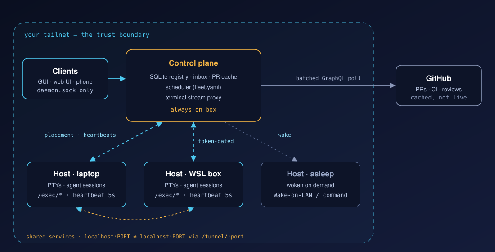

<p align="center">
  
</p>

<p align="center">
  <a href="LICENSE"></a>
  
  
</p>

Besiege is a command center for coding agents — terminals, agent sessions, notes, repos, and pull requests, all grouped around the work you're actually doing, with one place to see what needs your attention instead of hunting across terminals and GitHub. It treats every machine you own as one pool of compute: sessions land where there's room, you can attach to any of them from any box, and a machine that's asleep gets woken when there's work for it.

It works with **Claude Code**, **Codex**, **OpenCode** and **Antigravity (`agy`)**, and is built to run on a **[Tailscale](https://tailscale.com) tailnet** — see [Built for Tailscale](#built-for-tailscale).

> Besiege doesn't manage the agents — it manages *your* context and attention while the agents manage the code.

## Contents

- [What it does](#what-it-does)
- [The model: campaign → tabs → panels](#the-model-campaign--tabs--panels)
- [Why: the actual problem](#why-the-actual-problem)
- [Fleet: many machines, one control plane](#fleet-many-machines-one-control-plane)
- [Built for Tailscale](#built-for-tailscale)
- [Architecture](#architecture)
- [Getting started](#getting-started)
- [Status](#status)

## What it does

| | |
|---|---|
| 🗂 **Campaigns** | Tabs of panels (agent sessions, terminals, notes), pinned repos and a PR board, all scoped to one piece of work. Restart your machine and everything is where you left it, one click from resumed. |
| 🔀 **PR board** | Every PR touching a pinned repo, grouped by branch, then CI and review state. Batched GraphQL polling, rate-limit-safe at 1,200+ PRs. |
| 📥 **Inbox** | Agent sessions that are blocked, waiting or done relay into one board, so you don't have to notice a specific terminal. |
| 📜 **Edicts** | Your own path-scoped instructions for how agents behave under a directory glob, injected through the `SessionStart` hook. They never touch a shared `CLAUDE.md`/`AGENTS.md`, so they can't collide with a teammate's session. |
| 💬 **Status bar** | A seeded edict has agents call the `report_status` MCP tool whenever they finish something; the newest one-two sentence summary ("We were working on org/repo#42: …", with a link to the PR) sits in a bar at the bottom of the GUI. |
| 🧠 **Campaign memory** | Per-step playbooks and failure-signature records carried into subsequent sessions. |
| 🔌 **MCP interface** | `pr_state`, `pending_tasks`, `failure_pattern` and claim tools for agents — one call instead of three round-trips through the GitHub API. |
| 🛰 **Fleet** | Run sessions on whichever of your machines has room, attach to any of them from anywhere, share loopback services between hosts. [Details below.](#fleet-many-machines-one-control-plane) |
| 🖥 **Electron GUI + web UI** | A drag-and-drop terminal grid (WebGL-rendered), plus the same UI served over HTTP for an ordinary browser. |

## The model: campaign → tabs → panels

A **campaign** is a container for everything belonging to one piece of work — one migration across 300 repos, one feature spanning five services, a dozen agents working in parallel. It holds:

- **Tabs**, each a saved grid layout of **panels**.
- A panel is either an **agent session**, a **terminal session**, or a **note** — for context you're dissecting and don't want to keep scrolling back to find.
- **Pinned repos**, and a **PR board** that tracks every pull request touching them.

```
Campaign
├─ Tab: "backend"
│   ├─ Panel: agent session (packages/api)
│   ├─ Panel: terminal
│   └─ Panel: note — rollout checklist
├─ Tab: "frontend"
│   └─ Panel: agent session (packages/web)
├─ Pinned repos
└─ PR board (branch × CI × review)
```

Each session is hardwired to its panel, so there's no re-finding which terminal was doing what.

## Why: the actual problem

Running many agents at once, across many repos, breaks down in a few specific ways:

- **Work has no home.** A terminal tab is not a unit of work — it dies with the window and tells you nothing about what it was for.
- **Context doesn't survive.** Config and preferences live in ad-hoc CLAUDE.md edits; nothing carries forward what a prior session already learned about a recurring failure.
- **Attention is unscoped.** Knowing which of N terminals just asked a question means tab-hopping; knowing which of your PRs need you means opening GitHub over and over.
- **One machine isn't enough.** Agents are memory-hungry, and a few parallel sessions will get the OOM killer to take out the lot. Besiege was built by someone spreading agents across six physical computers to use every one of them: without a single view, you're left remembering which agent is on which box, which box is nearly out of memory, and which one is asleep.

### The scale case

This started from an org-wide rollout across ~300 repos producing ~1,200 PRs. GitHub's PR list and Projects views are one-dimensional and choke at that scale — there's no view shaped like the actual work. Besiege's PR board groups by branch first (a campaign usually pushes the same branch name everywhere), then by CI and review status, so "this branch is still failing CI somewhere" is one glance instead of a hundred tabs. It stays in sync with GitHub on a schedule via batched GraphQL, so both you and your agents read from one fast, already-fresh place instead of each agent hitting the GitHub API on its own — which, at this scale, is not just slower, it's a different order of magnitude slower.

## Fleet: many machines, one control plane

<p align="center">
  
</p>

Besiege treats every machine you can reach as one pool of compute. Start work anywhere, see every agent on every box in one place, and keep going on whichever machine you're sitting at, without caring which one is actually running it. It exists because six physical computers all had spare capacity, and OOM kills kept wasting it.

One always-on daemon is the **control plane**. It holds the registry of every session, the inbox and the scheduler. Every other machine runs its own daemon as a **host**, owning its PTYs and heartbeating load, memory and per-process RSS/CPU to the control plane every 5 seconds.

- **Placement.** A new session runs on the machine you started it from. If that machine is out of capacity, the scheduler walks `origin → pool → wake → last_resort`, using each agent's measured memory history to estimate what a session will cost. Placement lives in one `fleet.yaml` on the control plane.
- **Wake.** A sleeping host is woken with Wake-on-LAN, or any command run through a machine on its network, and gets the session once it heartbeats in.
- **Attach from anywhere.** Clients only ever talk to their own machine's Unix socket; a dispatcher forwards to the control plane while it's up and falls back to the local DB while it isn't. Terminal streams are proxied to whichever host runs the session.
- **Self-healing.** If a host crashes, the control plane resumes its agent sessions on the same host and posts to the inbox. Orphaned PTYs are reaped.
- **Shared services.** A service bound to one machine's loopback (say `localhost:1234`) can be reached at `localhost:1234` on the others, managed from the **Fleet** tab, and, where the web UI runs, also served at `/s/<name>/`. Traffic goes daemon to daemon over a websocket tunnel; the service itself is never put on the network.

Setup, `fleet.yaml` reference and the full behavior are in [`packages/daemon/README.md`](packages/daemon/README.md#fleet-several-machines-one-control-plane). What's built and what's next is in [`docs/fleet-roadmap.md`](docs/fleet-roadmap.md).

## Built for Tailscale

Besiege's fleet was designed around Tailscale from the start, and is tightly coupled to it. Be aware of that before you try to run it any other way.

- **The tailnet is the network.** Hosts reach each other on their Tailscale IPs. You set `BESIEGE_TCP_HOST` to the machine's tailnet address, and the control plane's `BESIEGE_PRIMARY_URL` is a tailnet address too. There's no discovery, relay or NAT traversal of Besiege's own — Tailscale's job is everything between machines.
- **The tailnet is the trust boundary.** The daemon executes arbitrary commands, so its TCP listener must never be bound beyond the tailnet (no `0.0.0.0`, no port-forwarding). A bearer token is generated on first run and required between daemons, but it is defense in depth on top of the tailnet, not a substitute for it.
- **Host naming follows Tailscale.** Host ids default to the lowercased machine name, matching how Tailscale names devices.
- **Encryption is Tailscale's.** Service tunnels are plain TCP between daemons and rely on WireGuard for confidentiality.
- **What it does not do:** Besiege doesn't call the Tailscale API or CLI, so there's nothing to authenticate against. Any private network with stable, mutually reachable addresses should technically work, but only a tailnet is what it's built, tested and secured around. Phone access is planned on `tailscale serve` with identity headers (see the [roadmap](docs/fleet-roadmap.md#1-phone--web-access-to-the-control-plane)).

Running a single machine needs no Tailscale at all.

## Architecture

```
 GUI (Electron)    TUI              besiege CLI
       \             |                  /
        \___________|_________________/
                     |
         local API (config · memory · PR cache · inbox)
                     |
                  Daemon
      (SQLite-backed state · sole GitHub writer)
                     |
   SessionStart / Notification hooks  |  scheduled GraphQL sync
                     |                                |
         Claude Code session                       GitHub
   (additionalContext injected,          (batched GraphQL poll,
         no file writes)                     interval-based)
```

The daemon is the single source of truth. The GUI, its web UI, and the TUI are all thin clients over its Unix socket API — no orchestration logic lives in any front-end. Across machines, the same daemon runs in the host and control-plane roles described [above](#fleet-many-machines-one-control-plane).

The full requirements and architecture spec is in [`docs/besiege-spec.md`](docs/besiege-spec.md).

### Packages

| Package | Description |
|---|---|
| [`packages/daemon`](packages/daemon) | HTTP API over a Unix socket, SQLite state, agent hooks, GitHub sync, fleet scheduler |
| `packages/gui` | Electron app — campaign grid, inbox, Fleet tab, config UI. Also ships a browser-based alternative (`src/web`) that reuses the same UI over HTTP/WebSocket instead of Electron IPC. |
| `packages/tui` | Terminal UI — **early-stage spike**, not wired into the root `pnpm dev` scripts. See [Status](#status). |

### Supported agents

Agent adapters are defined in [`packages/daemon/agents.default.yaml`](packages/daemon/agents.default.yaml); add your own in a gitignored `agents.local.yaml`.

| Agent | Launch | Resume | Hooks / MCP |
|---|---|---|---|
| Claude Code | `claude` | `--resume` | `SessionStart` + `Notification` hooks, per-launch MCP config |
| Codex | `codex` | `codex resume` | one-time `codex mcp add`; session id learned from its rollout files |
| OpenCode | `opencode` | — | — |
| Antigravity (`agy`) | `agy` | `--conversation` | reverse-engineered hooks, one-time `agy mcp add` |

## Getting started

```bash
pnpm install
pnpm dev:daemon   # daemon with hot reload
pnpm dev:gui      # Electron app
```

### Web UI (alternative to the Electron app)

Same UI, reachable from an ordinary browser instead of the Electron window.

```bash
pnpm web
```

One-shot convenience command: starts a daemon if none is already running (leaves an already-running one alone — restarting it would kill any live agent terminal sessions it's tracking), builds the web UI, serves it on `http://127.0.0.1:4571`, and prints the URL. Ctrl+C stops the web server only.

If you need the daemon restarted on latest source (e.g. after a daemon-side change, or if it wasn't running via `tsx watch`), use `pnpm daemon:reload` — this **does** end any live agent terminal sessions the daemon was tracking.

For active development on the web UI itself (rebuild on save), run in three terminals instead:

```bash
pnpm dev:daemon      # daemon with hot reload
pnpm dev:webclient   # builds the browser bundle, rebuilds on change
pnpm dev:webserver   # serves it + proxies to the daemon, on http://127.0.0.1:4571
```

The web server binds to `127.0.0.1` only and has **no authentication** — it grants shell/agent command execution to whoever can reach it, so it must never be exposed beyond localhost (e.g. don't port-forward it, don't bind it to `0.0.0.0`).

### Adding more machines

Follow the "Setup" steps of the daemon's [Fleet section](packages/daemon/README.md#setup): install and join Tailscale on each machine, give the control plane its tailnet IP in `BESIEGE_TCP_HOST`, and point every host at it with `BESIEGE_PRIMARY_URL` and the token from `$BESIEGE_STATE_DIR/tcp-token`. A starting `fleet.yaml` is in [`packages/daemon/fleet.example.yaml`](packages/daemon/fleet.example.yaml).

### Wiring agent hooks

Wire the hooks from [`packages/daemon/README.md`](packages/daemon/README.md) to enable config injection and the notification inbox.

## Status

This is a working daemon + GUI, actively evolving — not a finished product. Some of what the spec describes isn't built yet, and a few things that are built are intentionally provisional. Called out explicitly rather than left for you to discover:

- **No campaign closeout sweep.** A task added to a step after some of its PRs already merged only becomes `pending` on those PRs opportunistically — if the PR never gets touched again for an unrelated reason, that pending task just sits there forever. The scheduled sweep needed to actually guarantee completion (see [`docs/besiege-spec.md`](docs/besiege-spec.md#6-pr-tracking)) doesn't exist yet.
- **CI failure → memory linkage is half-wired.** Failure-signature records work fine on their own (create/lookup via the `failure_pattern` MCP tool), but the PR record's `ci_failure_signature_id` column — meant to point a failing PR at the matching signature automatically — isn't set by any code path yet. The two systems don't talk to each other yet.
- **Claims are advisory, not enforced.** Nothing stops a second agent from being dispatched to a PR someone else already claimed. Deliberate for now (dispatch is human-initiated), but worth knowing before you assume it's a safety net.
- **TUI (`packages/tui`) is an early-stage spike**, not at "full functional parity" with the GUI the spec calls for, and not wired into the root `pnpm dev`/`pnpm dev:*` scripts. Its own code notes that PTY pane full-screen rendering hasn't actually been verified against a live terminal yet.
- **Antigravity (`agy`) hook support was reverse-engineered** from the installed binary, not an official schema — treat it as a first pass likely to need correction, not a confirmed contract. Details and specific unknowns in [`packages/daemon/README.md`](packages/daemon/README.md#wiring-antigravity-agy-hooks).
- **GUI/TUI update model is still undecided** — push from the daemon vs. each client polling on an interval. Currently polling; not settled as the long-term answer.
- **Fleet is early.** No phone access yet (the web UI is localhost-only and unauthenticated), no moving a session between hosts, and attaching one session from two machines at once is rough (the terminal size flips between them). The ordered list is in [`docs/fleet-roadmap.md`](docs/fleet-roadmap.md).

If something looks unfinished, check [`docs/besiege-spec.md`](docs/besiege-spec.md)'s "Open questions" section first — several of these are known and deliberate, not oversights.

## License

[MIT](LICENSE)
